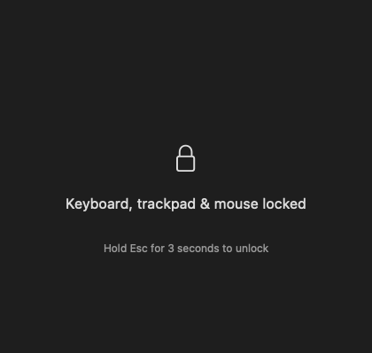
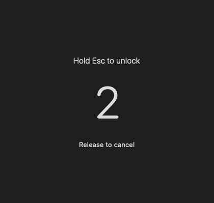

# CleanKeys 1.4 – a következő minőségi lépés

A cél a már elfogadott egyszerű használat megtartása: egy indítógomb, egyetlen elsötétítési kapcsoló, majd Esc 3 másodpercig. A változtatások a visszajelzéseket, a megbízhatóságot és az alkalmazás összeállítását javítják.

## 1.4.1 – a főablakban maradó tisztítás

Elsötétítés nélkül a CleanKeys főablaka mutatja a zárolást és az Esc-visszaszámlálót. A kezelőszervek finoman átadják a helyüket a lakatnak és a feliratnak; az Esc lenyomásakor középen a felfelé gördülő számok jelennek meg. Korai felengedésre visszatér a zárolási állapot, feloldáskor a kezelőfelület és a befejezési visszajelzés.

A világos és sötét, magyar és angol változatokban is ellenőriztem az indítás, zárolás, visszaszámlálás és befejezés elrendezését: mindegyik 420 × 399 pontos tartalomméretet tart. A főablakot a folyamat nem helyezi át. Külön kijelzőpanelt csak az elsötétített kijelzők kapnak.

## Elkészült

- **Befejezési visszajelzés.** Sikeres feloldás után „Kész is vagy” állapot és apró pipa jelenik meg. Az indítás rögtön elérhető marad; nincs új párbeszédablak vagy várakozás. Megszakítás esetén külön, bezárható magyarázat látható.
- **Egyszerűbb első beállítás.** Az engedélykérés után automatikus ellenőrzés indul. Az alkalmazás felismeri a hozzáférést, és további kattintás nélkül megjeleníti az indítást. A figyelés időben korlátozott és csak a kifejezett engedélykérés alatt fut.
- **Magyar és angol felület.** A felület, a hibaüzenetek és a kisegítő feliratok a rendszer preferált alkalmazásnyelvét követik. Új nyelvválasztó nem került a főablakra.
- **Kijelzőszám.** Az elsötétítési kapcsoló alatt látszik, hány csatlakoztatott kijelzőre vonatkozik a művelet.
- **Aktív zárolás ellenőrzése.** A zárolás idején másodpercenként ellenőrzi az alkalmazás a szűrő és az engedély állapotát. Megszűnésükkor teljesen felold. Üresjáratban ez az ellenőrzés nem fut.
- **Következetes eseménykezelés.** Megszűnt a felesleges második aszinkron lépés az Esc-események feldolgozásában. Egy lezárt munkamenet várakozó eseménye már nem befolyásolhatja a következő zárolást.
- **Azonnali takarítás megszakításkor.** Alváskor, munkamenetváltáskor és kilépéskor a feloldás szinkron módon történik. A mutató visszakapcsolásának egyetlen gazdája van, a takarítás sorrendje is egységes.
- **Többmonitoros elhelyezés ellenőrzése.** Külön ellenőrzések vizsgálják a főképernyőtől balra és fölötte található, eltérő méretű kijelzőket. A fekete módban minden kijelző a saját közepén mutatja ugyanazt a feloldási állapotot.
- **Megismételhető összeállítás.** Egyetlen parancs készíti el a logót, ikont és fordításokat tartalmazó alkalmazást, valamint a ZIP-csomagot. Készülhet Apple Silicon és Intel gépre közös változat. A verzió mindkét összeállítási úton 1.4.0, a buildszám 8.

## Ellenőrzések

A tesztek a tényleges alkalmazásforrásokat különálló fájlokként fordítják, és az eredeti állapotmodellen keresztül indítanak és állítanak le munkameneteket. Csak a rendszerhatásokat helyettesítik: nem telepítenek globális inputszűrőt, nem rejtik el a kurzort, és nem nyitnak blokkoló ablakokat.

Vizsgálják az engedély nélküli indítást, a részleges indítási hibák takarítását, az ismételt indítást, az Esc ismétlését és felengedését, a 3 másodperces küszöböt, a sikeres befejezést, a szűrő és az engedély elvesztését, az értesítésekre történő szinkron feloldást, a régi események eldobását, a csomagolt logót, a fordításokat és a többképernyős elhelyezést.

A kész alkalmazás főablakát és a benne megjelenő logót valódi alkalmazásablakban is ellenőriztem. A helyi build jelenleg még hozzáférést kér a macOS Kisegítő lehetőségekhez; ezt az engedélyt nem módosítottam.

## Kiadás előtt még szükséges

1. Valódi zárolási próba a felhasználó engedélyezett gépén, beépített/külső billentyűzettel, trackpaddel és több fizikai kijelzővel. A geometriai és állapotgép-ellenőrzések nem helyettesítik a hardveres tesztet.
2. Intel gépen futtatási próba. Az Intel-változat sikeres fordítása önmagában nem teljes futtatási teszt.
3. Nyilvános terjesztéshez stabil fejlesztői aláírás és notarizáció. A mostani csomag helyi fejlesztői aláírást kapott.

## A következő termékötletem

Ha a napi használat indokolja, a következő kényelmi fejlesztés egy opcionális menüsávos gyorsindító lehet. Csak akkor tenném hozzá, ha valóban gyakran kerülöd meg vele az alkalmazásablak keresését. A globális gyorsbillentyű, a profilok, a statisztika és a további kapcsolók egyelőre kevésbé szolgálnák a CleanKeys egyszerűségét.
