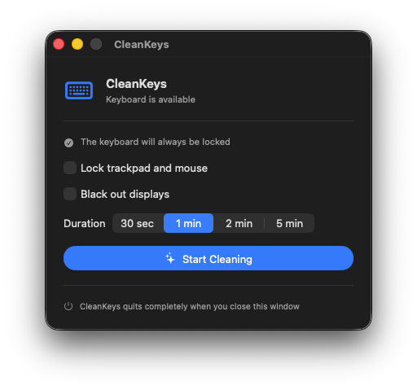

# CleanKeys

A minimal native macOS app that safely locks your keyboard while you clean it.



## Features

- Lock the keyboard for 30 seconds, 1, 2, or 5 minutes.
- Optionally lock the trackpad and mouse using a pinned hidden cursor and a full-screen input shield.
- Optionally black out every connected display.
- Unlock with a slider, or hold `Esc` for 3 seconds when all input is locked.
- Three-second countdown before locking.
- A regular app window; closing it quits CleanKeys completely.

## First launch

1. Open `CleanKeys.xcodeproj` in Xcode, or launch the prebuilt `Build/Release/CleanKeys.app`.
2. CleanKeys opens its control window.
3. Grant permission in **System Settings → Privacy & Security → Accessibility**.
4. Choose a duration and the options you want, then click **Start Cleaning**.

Accessibility permission is required because macOS only allows trusted apps to temporarily discard input events. CleanKeys does not record or store keystrokes.

## Safety behavior

If macOS temporarily disables the event filter, CleanKeys first attempts to restore it safely. If recovery fails, the Mac goes to sleep, or the user session changes, CleanKeys unlocks immediately. With all input locked, hold `Esc` for 3 seconds to unlock manually; the timer remains available as an automatic safety release.

## Build

Requires Xcode 16 or later and macOS 14 or later. The project has no external dependencies.

```sh
DEVELOPER_DIR=/Applications/Xcode.app/Contents/Developer xcodebuild \
  -project CleanKeys.xcodeproj \
  -scheme CleanKeys \
  -configuration Release \
  -derivedDataPath .derivedData \
  CODE_SIGNING_ALLOWED=NO \
  build
```
