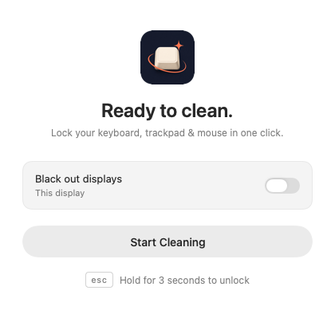

# CleanKeys

A small native macOS app for cleaning your keyboard, trackpad and mouse.

[Download CleanKeys for macOS](https://github.com/zsomborn0/CleanKeys/releases/latest/download/CleanKeys.zip) · macOS 14+ · Apple Silicon and Intel

The download is locally signed for development and is not yet notarized by Apple.



Click **Start Cleaning** to lock all input immediately. Hold **Esc for 3 seconds** to unlock. There is no duration picker or session timeout.

## Experience

- One remembered option: **Black out displays**. Keyboard, trackpad and mouse locking are always on.
- All connected displays receive input shields. Blackout adds a black surface and synchronized lock/countdown instructions on each screen.
- Without blackout, the existing CleanKeys window transitions from controls to lock status and the countdown, then back after unlocking. Its size and position stay stable.
- A minimal white lock on black; hold Esc to reveal the upward rolling 3–2–1 countdown. Release early to cancel. Reduce Motion uses a fade.
- A quiet **All set** confirmation after a completed session, with immediate access to start again.
- Native light/dark appearance, the CleanKeys logo, and English/Hungarian text following the system's preferred app language.
- Closing the main window quits the app completely. No account, network service or keystroke history.

## First use

1. Open CleanKeys and choose **Open Accessibility Settings**.
2. Enable CleanKeys in **System Settings → Privacy & Security → Accessibility**.
3. CleanKeys detects the change automatically during setup. Returning to the app or choosing **check again** also refreshes access.
4. Choose whether to black out displays, then start cleaning.
5. Hold Esc continuously for 3 seconds to finish.

A locally rebuilt, ad-hoc signed app may need its Accessibility permission refreshed after a code change. Quit an older running copy before opening a new build.

## Safety behavior

All lock effects are removed on sleep, session changes, termination, display configuration changes, lost Accessibility access, or a disabled input filter. A lightweight watchdog checks the active filter once per second while locked. There is no watchdog or permission polling during normal idle use; permission polling is limited to an explicit setup attempt.

When displays are attached/detached or rearranged during cleaning, CleanKeys unlocks and asks you to start again for the new arrangement. A held Escape key from before the session cannot unlock via auto-repeat. Queued input signals from a stopped session are discarded.

The cursor is restored after overlay cleanup. A successful end shows confirmation; an interrupted session shows a dismissible explanation.

## Build

macOS 14 or later. No external dependencies. Use Xcode or installed Apple Command Line Tools.

```sh
Scripts/build-app.sh
```

For an app containing both Apple Silicon and Intel binaries:

```sh
Scripts/build-app.sh --universal
```

Outputs: `Build/Release/CleanKeys.app` and `Build/Release/CleanKeys.zip`. The script stages the build, packages and verifies its resources, and signs it locally before replacing the previous build. Version metadata comes from the Xcode project. The logo, icon and translations are included without relying on an asset compiler.

The local script uses Command Line Tools when available. Set `DEVELOPER_DIR` explicitly to choose a full Xcode installation. An Xcode build is also supported:

```sh
DEVELOPER_DIR=/Applications/Xcode.app/Contents/Developer xcodebuild \
  -project CleanKeys.xcodeproj -scheme CleanKeys -configuration Release \
  -derivedDataPath .derivedData CODE_SIGNING_ALLOWED=NO build
```

The Xcode license must be accepted before using `xcodebuild`. Local signatures are for development; public distribution still requires a release signing/notarization process.

## Checks

```sh
Tests/run-tests.sh
```

The checks compile the production files unchanged, replacing only system effects through injected interfaces. They exercise real startup and failure paths, re-entry, preference migration, Escape cancellation/repeat handling and timing, stale signals, permission/filter loss, synchronous cleanup, logo loading, both translations, and HUD placement on unequal displays with negative coordinates. The tests never install a global event tap or hide the cursor.

Manual release checks remain necessary for real Accessibility-enabled input interception, physical trackpad gestures/media keys, sleep/wake, full-screen Spaces, and multiple physical displays. Building an Intel binary does not establish Intel runtime compatibility.

See [the 1.4 review](Docs/RELEASE-1.4.hu.md) for the changes and remaining release work.
